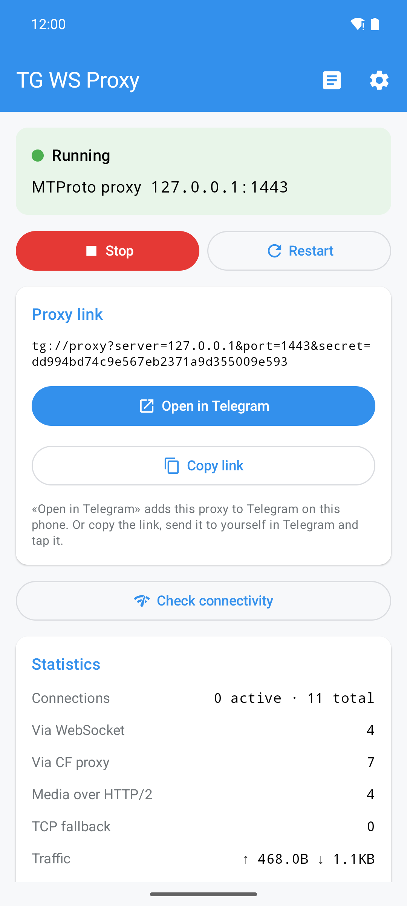
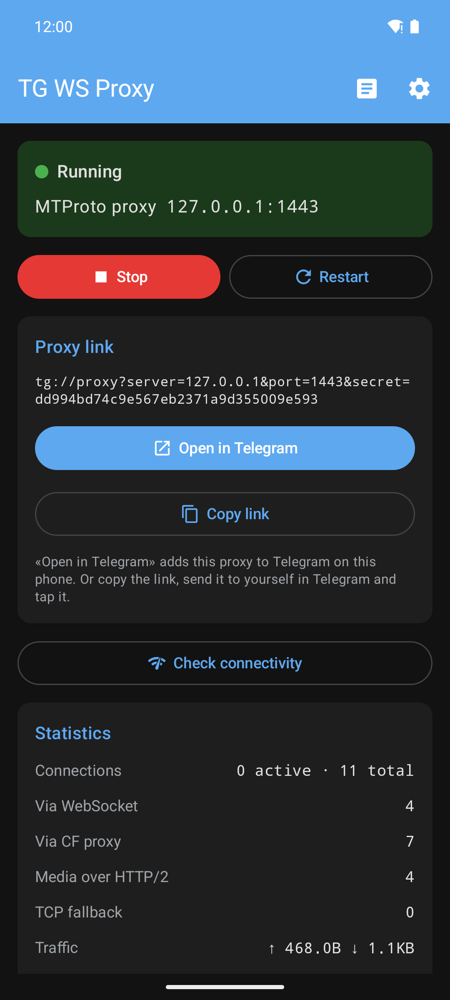

# TG WS Proxy — Android

[](https://github.com/ihtfw/tg-ws-proxy-android/actions/workflows/build.yml)

Native Android port of [tg-ws-proxy](https://github.com/Flowseal/tg-ws-proxy): a local **MTProto proxy** that speeds up Telegram by routing its traffic through WebSocket connections. Data stays end-to-end encrypted (MTProto); no third-party servers are needed.

<p align="center">
  
  &nbsp;&nbsp;
  
</p>

## How it works

```
Telegram → MTProto proxy (127.0.0.1:1443) → WebSocket (TLS) → Telegram DC
```

1. The app runs a local MTProto proxy on `127.0.0.1:1443`, protected by a secret of its own
2. It reads the target DC from the client's obfuscated init and re-encrypts the stream
3. It sends the stream to that DC over a pre-opened WebSocket to the DC's Telegram domain
4. If the WebSocket is not available, it falls back to your Cloudflare Worker, then to Cloudflare-proxied domains (CF proxy), then to a direct TCP connection

## Features

- **MTProto proxy** with a generated secret; one tap adds it to Telegram (`tg://proxy` link)
- **WebSocket pool** — connections to each DC are opened in advance, replaced every two minutes, and refilled with backoff; connections that fail directly are retried with another SNI
- **Cloudflare proxy fallback** — public domains, refreshed hourly from upstream's list, or your own domains ([setup](https://github.com/Flowseal/tg-ws-proxy/blob/main/docs/EN/CfProxy.md))
- **Cloudflare Worker fallback** — a free Worker of your own, tried first ([setup](https://github.com/Flowseal/tg-ws-proxy/blob/main/docs/EN/CfWorker.md))
- **HTTP/2 media multiplexing** — media connections share one connection to the Cloudflare proxy per DC
- **Fake TLS** (`ee` secret) — for a proxy reachable from other devices: looks like TLS to a real site and forwards anyone without the secret to that site
- **Test DCs** — test-environment DCs (10001+) are detected; they can also be forced for every connection ([details](https://github.com/Flowseal/tg-ws-proxy/blob/main/docs/EN/TestDc.md))
- **TCP fallback with backoff**, MTProto packet splitting, auto DC detection
- **Connectivity check** of every DC and fallback — plain, media and SNI fronting — **update check** (off by default), **logs** with the proxy secret and other domains masked, and sharing
- **Foreground service** with wake lock, **start on boot**, light and dark themes, English and Russian

## Quick start

1. Install the APK from the [Releases](https://github.com/ihtfw/tg-ws-proxy-android/releases) page
2. Open the app and tap **Start**
3. Tap **Open in Telegram** and confirm the proxy, or add it by hand:
   - Telegram → **Settings** → **Data and Storage** → **Proxy** → **Add Proxy** → **MTProto**
   - **Server:** `127.0.0.1`, **Port:** `1443`
   - **Secret:** `dd` followed by the secret shown in the app

Upgrading from 1.x, which was a SOCKS5 proxy on port 1080: remove the old SOCKS5 proxy in Telegram and add the new one with **Open in Telegram**.

> **Photos or videos do not load?** In the DC IPs setting remove everything except `4:149.154.167.220`; if that does not help, clear the field. This happens on accounts without Premium. If it still does not help, set up your own [Cloudflare domain](https://github.com/Flowseal/tg-ws-proxy/blob/main/docs/EN/CfProxy.md).

## Settings

| Setting | Default | Description |
|---------|---------|-------------|
| Port | `1443` | Local proxy port |
| Secret | random | 32 hex characters; Telegram uses `dd` + secret |
| DC IPs | `2:149.154.167.220`, `4:149.154.167.220` | WebSocket target IP per DC (`DC:IP`); other DCs use the fallbacks |
| CF proxy fallback | On | Fall back to Cloudflare-proxied domains |
| Own CF domains | Off | Your own domains instead of the public list |
| CF Worker domains | Off | Your Cloudflare Worker domains, tried first |
| HTTP/2 media | On | Multiplex media connections to the CF proxy |
| No TLS for Cloudflare | Off | Port 80 instead of TLS for CF proxy and Worker |
| Listen on all interfaces | Off | `0.0.0.0` instead of `127.0.0.1`, for other devices on the network |
| Fake TLS domain | empty | Enables the `ee` secret, masking as this domain |
| Force test DCs | Off | Send every connection to Telegram's test DCs |
| Pool size | `4` | Pre-opened WebSockets per DC (0 disables direct WebSockets) |
| Buffer KB | `256` | Socket buffer size |
| Start on boot | Off | Start the proxy when the device boots |
| Check updates on start | Off | Compare with the latest GitHub release (contacts api.github.com); nothing is installed |

Settings are applied with **Save & Restart**.

## Requirements

- Android 7.0+ (API 24)
- No root required

## Building from source

```bash
git clone https://github.com/ihtfw/tg-ws-proxy-android.git
cd tg-ws-proxy-android
gradle assembleDebug          # Gradle 9.3+, Android SDK 35
gradle testDebugUnitTest      # unit tests; TGWS_LIVE=1 adds tests against real Telegram DCs
```

The APK will be at `app/build/outputs/apk/debug/app-debug.apk`.

Release builds are signed when a `keystore.properties` file is present in the repository root
(it is git-ignored, so the file stays local):

```properties
storeFile=/path/to/keystore.p12
storePassword=…
keyAlias=key0
keyPassword=…
```

Without it `gradle assembleRelease` still works and produces an unsigned APK, which is what CI does.

## Credits

This is a native Android (Kotlin + Jetpack Compose) port of the original Python project [tg-ws-proxy](https://github.com/Flowseal/tg-ws-proxy) by [Flowseal](https://github.com/Flowseal) and its contributors.

## License

[MIT License](LICENSE)
